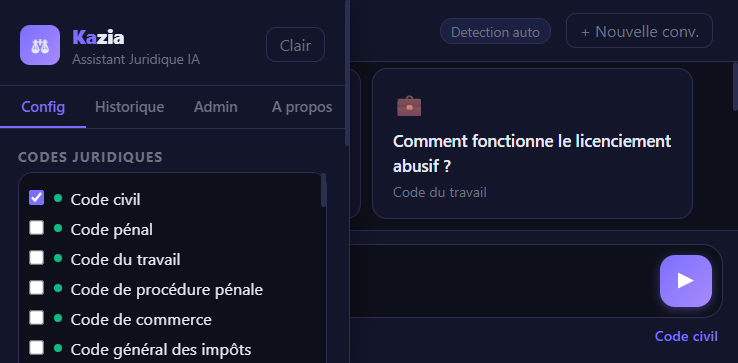
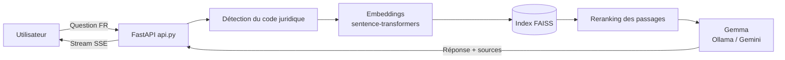

# ⚖️ Kazia — Assistant Juridique IA


**Kazia** est un assistant juridique français basé sur un moteur **RAG (Retrieval-Augmented Generation)** : les questions sont recherchées dans des index vectoriels **FAISS** construits à partir des textes officiels **Légifrance**, puis une réponse est générée avec **Gemma** (local via Ollama, ou Google Gemini) en citant précisément les articles de loi retrouvés.

> ⚠️ Projet pédagogique. Les réponses sont informatives et ne remplacent pas l'avis d'un professionnel du droit.

## 📸 Aperçu



## ✨ Fonctionnalités

- 🔎 Recherche dans un code juridique précis ou dans plusieurs codes à la fois (29 codes : civil, pénal, travail, commerce, consommation, santé...).
- 🧭 Détection automatique du ou des codes pertinents à partir de la question.
- 🗣️ Réponses en modes **Citoyen**, **Avocat**, **Étudiant** et **Résumé**.
- 📚 Affichage des sources, des numéros d'articles, des scores de similarité et du niveau de confiance.
- 💬 Streaming des réponses token par token (SSE).
- 🕘 Historique local des conversations dans le navigateur.
- 📤 Export TXT, Markdown et HTML imprimable en PDF.
- 🛠️ Tableau admin local : codes indexés, nombre de PDF, modèle utilisé, retours utilisateurs.
- 👍 Feedback utilisateur enregistré localement dans `feedback.jsonl`.

## 🏗️ Architecture



- **Récupération (retrieval)** : `rag/retrieval.py`, `rag/embeddings.py`, `rag/indexer.py`
- **Génération (LLM)** : `rag/llm.py`, `rag/generator.py`
- **Backend** : `api.py` (FastAPI, SSE streaming, détection de code, correction orthographique)
- **Frontend** : `static/index.html` (généré par `write_html.py`), SPA sans dépendance front lourde
- **Ingestion Légifrance** : `legifrance/` (auth OAuth2 PISTE, client API, export PDF), `updater/` (mise à jour planifiée des textes)

## 📦 Installation

```powershell
python -m venv .venv
.\.venv\Scripts\Activate.ps1
pip install -r requirements_rag.txt
```

Installez [Ollama](https://ollama.com/), puis téléchargez le modèle Gemma local :

```powershell
ollama pull gemma3:12b
```

Copiez `.env.example` vers `.env` et complétez les valeurs :

```text
LLM_PROVIDER=ollama
OLLAMA_BASE_URL=http://127.0.0.1:11434
OLLAMA_MODEL=gemma3:12b
GEMMA_MODEL=gemma3:12b
CORS_ORIGINS=*
PISTE_CLIENT_ID=
PISTE_CLIENT_SECRET=
PISTE_API_KEY=
```

## ▶️ Lancer l'application

```powershell
uvicorn api:app --host 127.0.0.1 --port 8000 --reload
```

Ouvrez ensuite [http://127.0.0.1:8000](http://127.0.0.1:8000).

## 🧱 Construire un index

Depuis l'interface, utilisez le bouton de construction à côté d'un code non indexé.

En ligne de commande, pour le Code civil par défaut :

```powershell
python rag_code_civil.py --build
```

## 💻 Utilisation CLI

```powershell
python rag_code_civil.py --query "divorce par consentement mutuel"
python rag_code_civil.py --ask "quelles sont les causes de divorce ?"
```

## 🧪 Tests

```powershell
pytest -q
```

Si la suite complète est lente, lancez d'abord les tests ciblés :

```powershell
pytest -q tests/test_rag_retrieval.py tests/test_api.py
```

## 🔒 Sécurité

- **Secrets** : aucune clé n'est codée en dur. `PISTE_CLIENT_ID` / `PISTE_CLIENT_SECRET` / `GOOGLE_API_KEY` se configurent uniquement via `.env` (ignoré par git). Ne commitez jamais `.env`.
- **CORS** : `CORS_ORIGINS=*` convient en local ; en production, remplacez par la liste exacte de vos domaines (séparés par des virgules).
- **Données volumineuses** : les index FAISS (`faiss_index_*/`) et les PDF sources (`pdfs/`, `pdfs2/`) ne sont pas versionnés (trop lourds) ; reconstruisez-les localement avec `fetch_codes_complets.py` puis `--build`.
- **Feedback** : `feedback.jsonl` peut contenir des questions utilisateur — ne le partagez pas publiquement.
- Les réponses sont informatives et ne remplacent pas l'avis d'un avocat ; vérifiez toujours les articles cités sur les sources officielles (Légifrance).

## 📁 Structure du projet

```text
api.py                  # Backend FastAPI (SSE, détection de code, endpoints)
rag_code_civil.py       # CLI RAG (build / query / ask)
rag/                    # Moteur RAG (embeddings, index, retrieval, LLM)
legifrance/             # Client API Légifrance (OAuth2 PISTE, export PDF)
updater/                # Mise à jour planifiée des textes de loi
static/                 # Frontend (SPA générée par write_html.py)
tests/                  # Suite de tests pytest
faiss_index_*/          # Index vectoriels (non versionnés)
pdfs/, pdfs2/           # Textes sources Légifrance (non versionnés)
```

## 📄 Licence

MIT — voir le code source pour le détail des modules.
